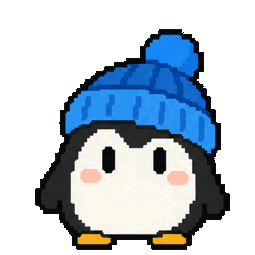

## Why the change
Idle breathing was already implemented, but its 1% scale made it hard to notice and image-set refreshes could leave it missing, so this change makes the motion visible and reliably restored.

## Special things to note
- [x] User-visible UI change
- Breathing remains controlled by the existing user preference and keeps its 3.2-second cadence.



## Change outline
Idle animation setup, preference changes, and image refresh now use the same visible breathing scale:

```diff
 idle
   show(idleFrame)
-  breathe(scale: 1.01, duration: 3.2)
+  breathe(scale: 1.03, duration: 3.2)
   scheduleBlink()
```

```text
Sources/WaddlyApp/
└── PetAnimationController.swift       # idle motion and refresh restoration
Tests/WaddlyAppTests/
└── AnimationControllerTests.swift     # breathing and preference regression coverage
```
