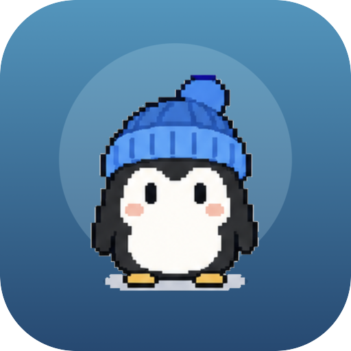
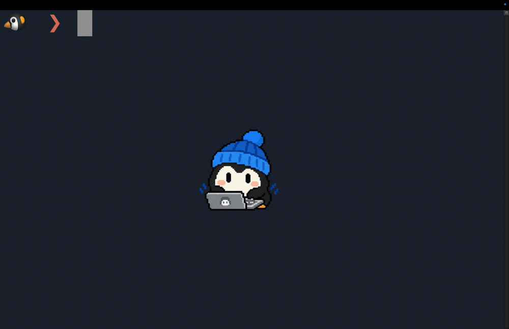
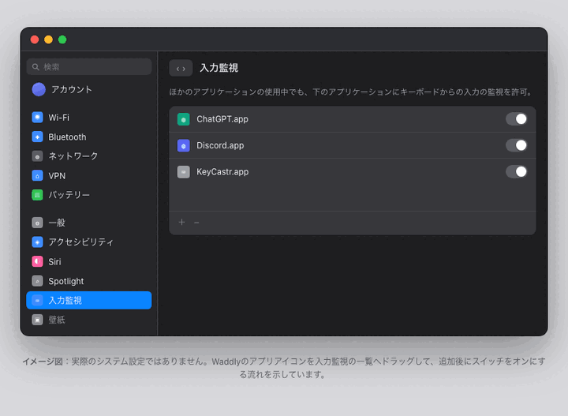
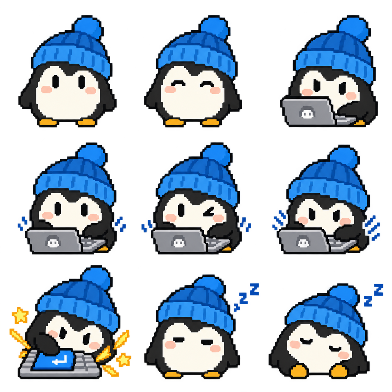

<div align="center">

  

  <h1>Waddly</h1>

</div>

<p align="center">自分のペットをデスクトップに表示し、キー入力に合わせて動かせるmacOSアプリです。</p>

<p align="center"><a href="README.md">English README</a></p>

<p align="center">

  

</p>

## Waddlyでできること

- 自分のペットの画像を登録できます。
- キー入力に合わせてペットが動きます。入力した文字やキーコードは保存しません。
- 待機中は呼吸やまばたきをし、時間がたつと眠ります。
- ペットはデスクトップ上でドラッグでき、好きな位置に配置できます。
- ペットはすべてのデスクトップ（Space）に表示されます。フルスクリーンアプリの上には表示されません。
- ペットを右クリックして「ペットをシェア」を選ぶと、5秒のMP4（384 × 384）と3×3のPNGスプライトシート（9コマ）を端末内で作成します。動画または画像をコピーでき、「Xでポストする」では「#ShareMyWaddly」だけが入った投稿画面が開くので、文章とファイルは自分で添付します。シェア素材をファイルとして保存する機能はありません。

## はじめる

WaddlyはApple Silicon搭載MacのmacOS 14以降で動作します。インストール方法は2つです。

### Homebrewでインストール

今後の更新もHomebrewで行いたい場合に向いています。Homebrew 6.0以降ではサードパーティのCaskを明示的に信頼する必要があるため、次のコマンドで、インストールするCaskだけを信頼します。

```sh
brew tap nyatinte/waddly
brew trust --cask nyatinte/waddly/waddly
brew install --cask waddly
```

更新するには `brew upgrade --cask waddly` を実行します。信頼を取り消すには `brew untrust --cask nyatinte/waddly/waddly` を実行してください。

### GitHub Releasesからインストール

[最新リリース](https://github.com/nyatinte/Waddly/releases/latest)から `Waddly-<バージョン>-macos-arm64.dmg` をダウンロードして開き、Waddlyをアプリケーションフォルダへドラッグします。同じリリースにある `.sha256` でチェックサムを確認できます。

配布アプリはad-hoc署名で公証されていないため、初回起動時にGatekeeperが止めることがあります。「システム設定 → プライバシーとセキュリティ → このまま開く」で許可してください。macOS 15以降ではControlキーを押しながらの「開く」では解除できません。

ソースから試す場合は、開発者向けの[ビルド手順](CONTRIBUTING.md)を参照してください。

初回起動時はセットアップガイドに沿って画像を登録してください。

### キー入力への反応を有効にする

2つ目のステップで「入力監視」の許可を求めます。アイコンを一覧へドラッグして、Waddlyをオンにしてください。

許可しただけでは確認済みにはなりません。実際にキーを押してペットが反応すると「確認済み」になり、次のステップへ進めます。



macOSが許可を反映するのはアプリの再起動後です。「Waddlyを再起動」を押すと、再起動後も同じステップからセットアップが再開します。

## 自分のペットを使う

### 画像を用意する

[ChatGPT](https://chatgpt.com/)などの画像生成サービスに[生成用プロンプト](prompts/ja.md)を送ると、3×3のスプライトシートを作成できます。

<details>
<summary>生成用プロンプトを表示</summary>

```text
作りたいキャラクター：＜ここに書き換える＞

この行が空欄か「＜ここに書き換える＞」のままの場合は、どんなペットやキャラクターを作りたいか、先にユーザーへ質問してください。

上記のキャラクターで、Waddly用の3×3アニメーションスプライトシートを作成してください。参考にしたい画像を添付している場合は、その画像の個体を描いてください。

【キャラクター】
- 個体の特徴（種類、色、模様、体型）を全コマで保つ。

【画風】
- 16-bit機のゲーム風のピクセルアート。色数は少なく、輪郭は太く、陰影は2〜3段階。
- ぼかし、アンチエイリアス、グラデーション、光彩、写真風の表現は使わない。
- 9コマで同じ大きさ、同じ向き、同じカメラ位置にする。キャラクターの頭の上端・体の下端・左右の中心を、9コマですべて同じ位置にそろえ、動きで変えない。

【シートと配置】
- 透過PNGを1枚だけ出力する。3×3の9コマ。セルは同じ大きさの正方形にし、辺の長さは3で割り切れる値にする。
- 背景は本物の透明にし、キャラクターの輪郭の外側はアルファ0にする。チェッカー柄、白、灰色、色付きの背景、グラデーション、地面、影は描かない。
- キャラクター全体を各セルの中央50%の範囲（四辺に25%ずつの余白）に収める。耳、しっぽ、羽、キーボード、エフェクトもすべて内側に置く。
- セルの境界や隣のセルに1ピクセルでも触れたセルは、不正な出力とみなす。
- 収まらない場合は、キャラクターを小さくするのではなく、ポーズやエフェクトを控えめにする。
- 枠線、区切り線、番号、説明文、ロゴ、透かしは描かない。Enterキーの記号以外の文字は入れない。

【9コマ：左上から右へ、上から下】
1. リラックスして座っている
2. 1コマ目と同じ姿勢でまばたきしている
3. 集中した表情でキーボードに向かっている
4. ゆっくりタイピングしている
5. 4コマ目と少し違う姿勢でタイピングしている
6. 前のめりになって速くタイピングしている
7. 大きなEnterキーを勢いよく押し込む瞬間。参考画像を添付している場合はその勢いを参考にする
8. まぶたが重く、うとうとしている
9. 丸くなって安心して眠っている

【キーボードとエフェクト】
- 3〜7コマ目にだけ、9コマで同じ形・同じ大きさの小さなキーボードを描く。幅はセル幅の40%以下にする。
- 7コマ目はEnterキーを他のキーより大きく描く。Enterキーもセル幅の30%以内に収める。「↵」の記号は付けてもよいが、「Enter」などの文字は書かない。
- 7コマ目の星形のきらめきと衝撃線は、体のすぐそばに置く。線は短いものを2本までにし、体の外側へセル幅の5%を超えて伸ばさない。先端はセルの右端と下端から30%以上内側に置く。

この条件に合うスプライトシート画像だけを出力してください。
```

</details>

- 手持ちの画像をもとに作る場合は、ペットやキャラクターの画像をプロンプトと一緒に送ってください。
- 画像がない場合は、「丸い体の小さなペンギン」のように、作りたいキャラクターを文章で指定してください。画像の添付は不要です。

スプライトシートは手作業で作成することもできます。

| 参照画像                                                    | 3×3スプライトシート                                                         |
| ------------------------------------------------------- | ------------------------------------------------------------------- |
|  |  |

### 画像の条件

- 透過PNGで、縦横が同じ長さの画像
- 縦横のピクセル数が3で割り切れること
- ファイルサイズは20 MB以下、各辺4096 px以下

AIが生成したシートは、プロンプトで位置を指定しても、コマごとにキャラクターの縦位置がずれる（ピッチのずれ）ことがあります。3×3シートを読み込んだあとに「フレームを調整…」を開くと、下書き上でクロップと位置合わせを編集できます。固定マッピング（待機2・入力中4・登場1・スリープ2）の9コマが表示され、1:1クロップを狭めてもキャラクターは動かず、位置合わせツールでキャラクター自体を移動できます。キャンバスはトラックパッドでパン／ズームでき、⌘+/⌘−/⌘0でも操作できます。中央十字線付きの調整前後プレビューで確認できます。

長辺3072 pxを超えるシートは読み込み時に縮小され、個別画像は最大1024 pxになります。共通のキャラクター画面では、PNGファイルの選択、ウィンドウ全体へのドロップ、「クリップボードから貼り付け」（⌘V）が使えます。変更は「続ける」か「適用」を押すまで下書きのままです。

ペットを右クリックすると、サイズや動作、言語、表示先、ログイン時の起動を変更できます。項目が無効な場合は、必要な条件を標準メニューのヘルプで説明します。Dockまたはメニューバーのどちらかは表示したままにする必要があります。

Waddlyが前面にあるときは、画面上部のメニューバーにも標準のメニューが並びます。「Waddly」メニュー（「Waddlyについて」でバージョンとビルド番号を確認できます。ほかに「Waddlyを隠す」「Waddlyを終了」）、テキスト入力で⌘C／⌘Vが使える「編集」、開いているウインドウを扱う「ウインドウ」です。

設定完了後は「入力監視を設定…」から許可・状態確認・復旧の案内へ直接入り、「キャラクターを変更…」で画像を差し替えたり編集したりできます。初回・未完了時は「セットアップガイド…」が開きます。セットアップガイドと「キャラクターを変更…」は同じキャラクター画面を使い、選んだ画像は「続ける」か「適用」を押すまで下書きのままです。保存に失敗した場合は下書きを保持して再試行でき、下書きを変更したまま閉じると破棄の確認を表示します。保存済みのペットを表示している間は「現在使用中」、置き換える下書きがある間は「変更はまだ保存されていません」と表示されます。「適用」は保存済みのペットと異なる下書きがあるときだけ押せますが、セットアップガイドの「続ける」は変更がなくても次へ進めます。

登録後に別のキャラクターを作るときは、メニューバーかペットの右クリックメニューから「キャラクターを変更…」を開いてください。登録済みのペットや取り込み中の画像があっても、「別のキャラクターを作る」カードから生成用プロンプトにアクセスできます。「プロンプトをコピー」はアプリの表示言語に合ったプロンプトをコピーし、ブラウザーは開きません。「プロンプトをコピーしてChatGPTを開く」ならChatGPTも開きます。使いたい画像生成サービスに貼り付け、完成したPNGをこの画面で取り込んでください。コピー操作では現在のペットも下書きも変更されず、「適用」を押したときだけ保存します。Waddlyから画像生成サービスへ画像を送信することはありません。

画像がまだない場合は「まずサンプルで試す」で同梱のサンプルをすぐに表示できます。サンプルも他のペットと同じくローカルに保存され、「画像を変更」でいつでも差し替えられます。

画像はコマごとのPNGとして端末内に保存されます。フレーム編集を使った場合は、元の3×3シートとクロップ・位置合わせのメタデータもあわせて保存されます。元ファイルは変更せず、ネットワークへ送信しません。古いプロンプトで作成した画像はコマの順番が異なることがあるため、現在のプロンプトを使用してください。

## プライバシー

入力イベントはアニメーションの制御に使います。入力内容やキーコードを保存・記録・送信しません。画像は端末内に保存します。シェア素材もダイアログを開いたときに端末内で作成し、Waddlyからアップロードしません。コピーとXへの投稿はユーザーの操作で行います。Xロゴまたはテキストから投稿画面を開けますが、素材の添付や投稿は自分で行います。投稿画面にはハッシュタグ「#ShareMyWaddly」だけが入力され、本文は空のままなので自分で書けます。動画はファイルとしてコピーされるため、Xの投稿欄やチャットへ貼り付けて添付できます。

## メモリ実測

通常の利用では、メモリの物理フットプリント100 MB未満を目標にしています。非常に大きなシート（例: 3072 × 3072・9コマ）を取り込むと、この目標を超えることがあります（1.0での既知の例外）。計測手順と回帰テストは[CONTRIBUTING.md](CONTRIBUTING.md)を参照してください。フレーム調整エディタは、画像の入力条件が同じ間はBeforeとAfterのプレビューを各1件だけ再利用し、ズームやガイド表示の変更だけでは画像を再生成しません。後始末処理ではデコード済みシートとプレビューへの参照を破棄しますが、シートを閉じてもプロセス全体のメモリがすぐに元へ戻るとは限りません。

## コントリビュート

開発への参加方法は[CONTRIBUTING.md](CONTRIBUTING.md)を参照してください。

## ライセンス

ソフトウェアは[MIT License](LICENSE)で公開し、ライセンス文をアプリにも同梱しています。
