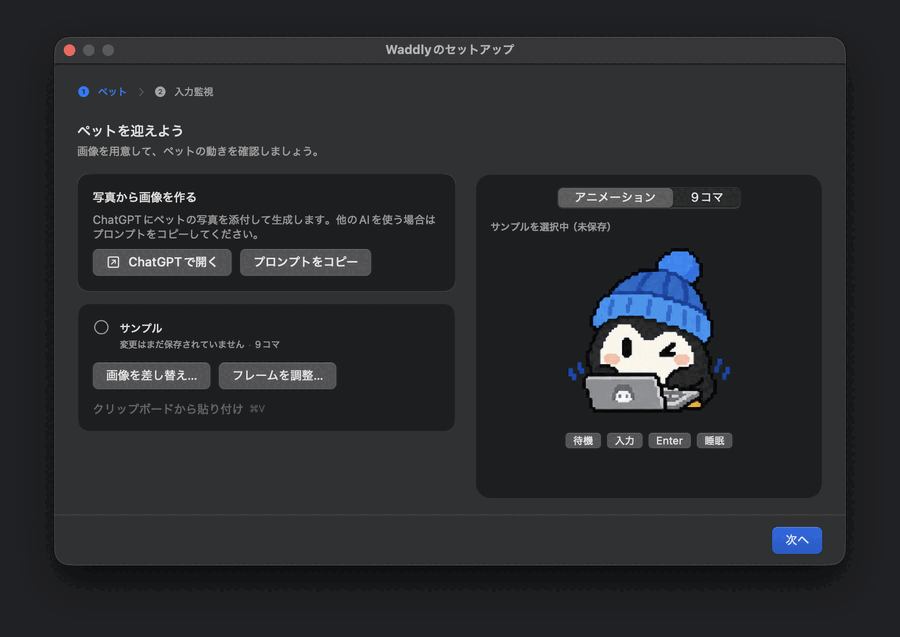
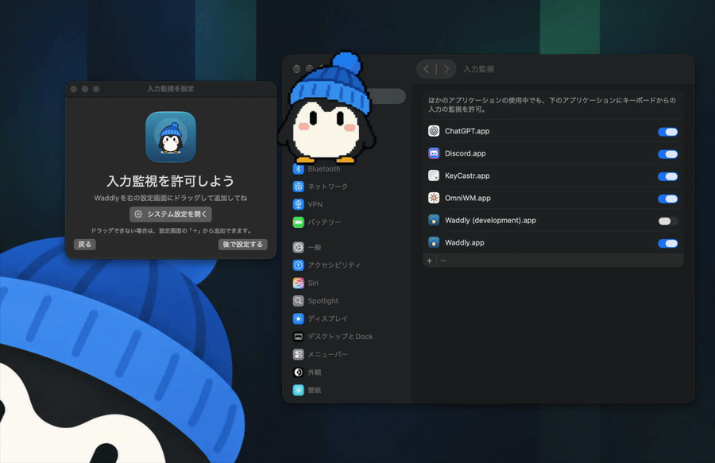
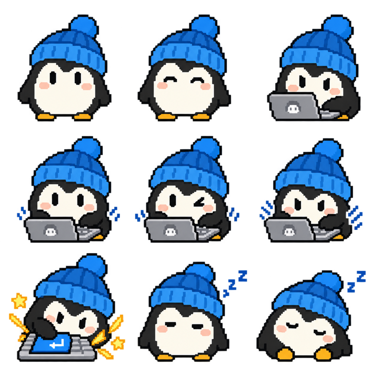

<div align="center">

  

  <h1>Waddly</h1>

</div>

<p align="center">自分のペットをデスクトップに表示し、キー入力に合わせて動かせるmacOSアプリです。</p>

<p align="center"><a href="https://github.com/nyatinte/Waddly/releases/latest">DMGをダウンロード</a> · <a href="#homebrewでインストール">Homebrew</a> · macOS 14+ / Apple Silicon</p>

<p align="center"><a href="README.md">English README</a></p>

<p align="center">

  

</p>

## Waddlyでできること

- 自分のペットの画像を登録できます。初期設定ではサンプルを選ぶとプレビューが切り替わり、「次へ」で保存されます。入力監視を後で設定する場合は、ペットの準備ができたことと、キー入力への反応が未設定であることを最後の画面で案内します。macOS 26以降では、初期設定、キャラクターの取り込み、フレーム編集、権限案内、シェア画面の背景にシステムの素材を使い、主要な操作ボタンにLiquid Glassスタイルを使用します。
- キー入力に合わせてペットが動きます。入力した文字やキーコードは保存しません。
- 待機中は呼吸やまばたきをし、時間がたつと眠ります。
- ペットはデスクトップ上でドラッグでき、好きな位置に配置できます。
- ペットはすべてのデスクトップ（Space）に表示され、通常のアプリのウインドウより手前に表示されます。アプリやSpaceを切り替えるたびに前面へ戻るため、他のアプリのフローティングパネルに覆われ続けることはありません。フルスクリーンアプリの上には表示されず、メニューバーやSpotlightはペットより手前に表示されます。
- ペットを右クリックして「ペットをシェア」を選ぶと、動くペットの動画や画像をコピーしてSNSやチャットに貼り付けられます。

## はじめる

### Homebrewでインストール

```sh
brew tap nyatinte/waddly
brew install --cask nyatinte/waddly/waddly
```

更新するには `brew upgrade --cask waddly` を実行します。

### GitHub Releasesからインストール

[最新リリース](https://github.com/nyatinte/Waddly/releases/latest)から `Waddly-<バージョン>-macos-arm64.dmg` をダウンロードして開き、Waddlyをアプリケーションフォルダへドラッグします。同じリリースにある `.sha256` でチェックサムを確認できます。

配布アプリはad-hoc署名で公証されていないため、初回起動時にGatekeeperが止めることがあります。macOSが初回起動を止めた場合は、「システム設定」→「プライバシーとセキュリティ」を開き、セキュリティまでスクロールして「このまま開く」をクリックしてください。macOS 15以降ではControlキーを押しながらの「開く」では解除できません。

ソースから試す場合は、開発者向けの[ビルド手順](CONTRIBUTING.md)を参照してください。

### キー入力への反応を有効にする

「設定をはじめる」を選ぶと、「システム設定 → プライバシーとセキュリティ → 入力監視」が開き、横に小さな案内ウィンドウが表示されます。Waddlyが一覧にない場合は、実際のアプリアイコンを一覧へドラッグします。ドラッグできない場合は＋ボタンから追加してください。一覧にあるWaddlyのスイッチをオンにします。案内のアニメーションは操作例で、権限の付与やシステム上のドラッグは行いません。確認が出たら「終了して再度開く」を選びます。

案内ウィンドウは邪魔にならない場所へ移動できます。クリックしてから⌘Wを押すと閉じられます。



## 自分のペットを使う

### 画像を用意する

ペットの写真を用意して、Waddlyの「ChatGPTで開く」を選びます。ChatGPTに写真を添付して画像を作り、Waddlyに戻ってPNGを取り込んでください。他の画像生成サービスを使う場合は「プロンプトをコピー」を選びます。[生成用プロンプトと画像の確認方法](prompts/ja.md)も参照できます。

スプライトシートは手作業で作成することもできます。

| 参照画像                                                    | 3×3スプライトシート                                                         |
| ------------------------------------------------------- | ------------------------------------------------------------------- |
|  |  |

### 便利な機能とデータの保存先

- 反応しない場合は、案内の「動作しない場合」からWaddlyを再起動するか、システム設定で入力監視を確認してください。
- 新しいキャラクターを作るときは、「キャラクターを変更…」で表示言語に合った生成用プロンプトをChatGPTで開いたり、コピーしたり、完成したPNGをその画面から取り込んだりできます。ChatGPTを開くとプロンプトがページのURLに含まれるため、ブラウザの履歴にも残ります。「プロンプトをコピー」なら履歴に残りません。
- ペットのサイズ・動作・表示言語・表示先・ログイン時起動・入力監視は、ペットの右クリックメニューまたはメニューバーから変更できます。
- 取り込んだ画像や調整内容はMac内に保存され、元の画像ファイルはそのまま残ります。Waddlyが自分から外部へ画像やプロンプトを送信することはありません。

## プライバシー

キー入力はペットのアニメーションにだけ使い、保存・記録・送信はしません。画像やシェア用の動画・画像はMac上で処理し、自動ではアップロードしません。「Xでポストする」は「#ShareMyWaddly」入りの投稿画面を開くだけで、「ChatGPTで開く」のときだけ同梱のプロンプトがChatGPTに渡ります。

## コントリビュート

開発への参加方法は[CONTRIBUTING.md](CONTRIBUTING.md)を参照してください。

## アンインストール

Homebrewで入れた場合は、次を実行します。

```sh
brew uninstall --cask waddly
```

あわせて「システム設定 → プライバシーとセキュリティ → 入力監視」の一覧から Waddly を削除してください。

DMGで入れた場合は、Waddlyを終了してアプリケーションフォルダのWaddly.appをゴミ箱に入れてください。

## シェアとフィードバック

ペットの様子は X で [#ShareMyWaddly](https://x.com/hashtag/ShareMyWaddly) を付けてシェアしてください。不具合報告や機能要望は [GitHub Issues](https://github.com/nyatinte/Waddly/issues) へ。気に入ったらリポジトリに Star を付けてもらえると嬉しいです。

## ライセンス

ソフトウェアは[MIT License](LICENSE)で公開し、ライセンス文をアプリにも同梱しています。
