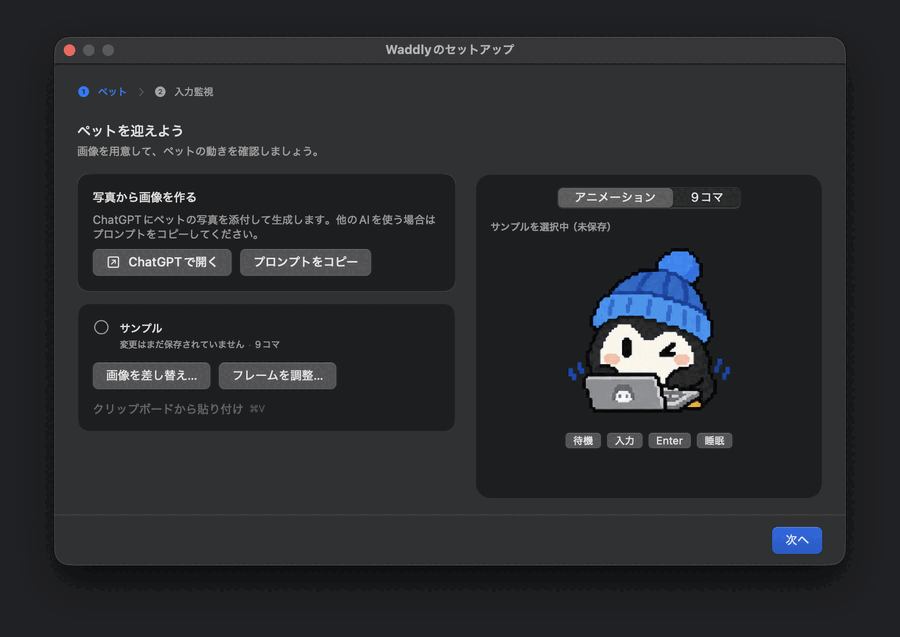
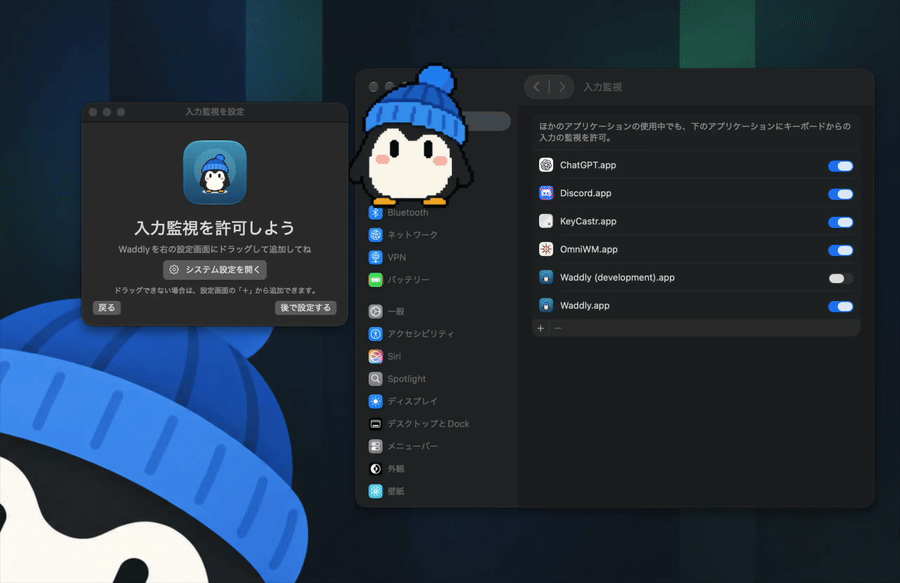
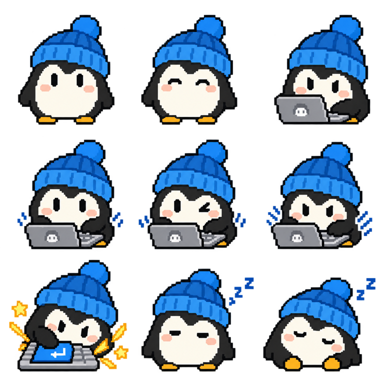

<div align="center">
  
  <h1>Waddly</h1>
</div>

<p align="center">Put your pet on your Mac desktop and let it react to keyboard input.</p>

<p align="center"><a href="https://github.com/nyatinte/Waddly/releases/latest">Download DMG</a> · <a href="#install-with-homebrew">Homebrew</a> · macOS 14+ / Apple Silicon</p>

<p align="center"><a href="README.ja.md">日本語README</a></p>

<p align="center">
  
</p>

## What Waddly does

- Add your own pet images.
- Your pet reacts to keyboard input. Typed text and key codes are not stored.
- While idle, it breathes and blinks, then falls asleep after a while.
- Drag your pet anywhere on the desktop.
- The pet joins every desktop Space and stays above ordinary app windows. It returns to the front whenever you switch apps or Spaces, so another app's floating panel cannot keep covering it. It does not appear above a fullscreen app, and the menu bar and Spotlight stay in front of it.
- Right-click the pet and choose “Share Pet” to copy a video or image of your pet and paste it into X or chat apps.

## Install

### Install with Homebrew

```sh
brew tap nyatinte/waddly
brew install --cask nyatinte/waddly/waddly
```

Update with `brew upgrade --cask waddly`.

### Install from GitHub Releases

Download `Waddly-<version>-macos-arm64.dmg` from the [latest release](https://github.com/nyatinte/Waddly/releases/latest), open it, and drag Waddly into your Applications folder. Verify the download with the `.sha256` file in the same release.

The app is ad-hoc signed and not notarized, so Gatekeeper may block the first launch. If macOS blocks the first launch, open System Settings → Privacy & Security, scroll to Security, and click Open Anyway. On macOS 15 or later, Control-click → Open no longer clears the warning.

To try Waddly from source, follow the developer [build instructions](CONTRIBUTING.md).

### Turning on keyboard reactions

Choose **Start setup**. Waddly opens **System Settings → Privacy & Security → Input Monitoring** and keeps a small guide beside it. If Waddly is not listed, drag its real app icon into the list, or use **+** if drag-and-drop is unavailable. Turn on Waddly’s switch in the list. The guide’s animated example is visual only; it does not grant permission or perform a system drag. If macOS asks, choose **Quit & Reopen**.

You can move the guide out of the way, or click it and press ⌘W to close it.



## Use your own pet

### Prepare a sprite sheet

Prepare a photo of your pet and choose **Open in ChatGPT** in Waddly. Attach the photo in ChatGPT, then return to Waddly and import the generated PNG. To use another image generator, choose **Copy prompt**. You can also view the [prompt and image-checking tips](prompts/en.md).

You can also create the sprite sheet by hand.

| Reference image | 3×3 sprite sheet |
| --- | --- |
|  |  |

### Tips and local storage

- If the pet does not react, choose **If it does not work** in the guide to restart Waddly or check Input Monitoring in System Settings.
- When creating a new character, choose **Change Character…** to open the generation prompt in ChatGPT in the current app language, copy it for another image generator, or import a finished PNG at any time in that window. Opening ChatGPT puts the prompt in the page URL, so it is also recorded in your browser history; **Copy prompt** leaves no trace there.
- Right-click the pet or use the menu bar icon to change pet size, behavior, language, visibility, launch at login, or Input Monitoring settings.
- Imported images and alignment edits are saved on your Mac, leaving your original files untouched. Waddly uploads nothing by itself.

## Privacy

Keystrokes are used only to animate the pet and are never stored, logged, or sent. Images and share videos or images stay on your Mac and are never uploaded automatically. “Post on X” only opens a compose window with `#ShareMyWaddly`, and only “Open in ChatGPT” sends the bundled prompt to ChatGPT.

## Contributing

See [CONTRIBUTING.md](CONTRIBUTING.md) for development setup and contribution instructions.

## Uninstall

If you installed with Homebrew:

```sh
brew uninstall --cask waddly
```

Also remove Waddly from System Settings → Privacy & Security → Input Monitoring.

If you installed from the DMG, quit Waddly and move /Applications/Waddly.app to the Trash.

## Share and feedback

Share your pet with [#ShareMyWaddly](https://x.com/hashtag/ShareMyWaddly) on X. Report bugs or request features via [GitHub Issues](https://github.com/nyatinte/Waddly/issues). If you enjoy Waddly, a star on the repo helps a lot.

## License

The software is released under the [MIT License](LICENSE), which is also included in the app bundle.
