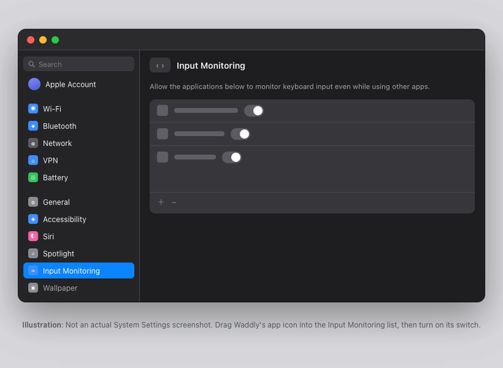

<div align="center">
  
  <h1>Waddly</h1>
</div>

<p align="center">Put your pet on your Mac desktop and let it react to keyboard input.</p>

<p align="center"><a href="README.ja.md">日本語README</a></p>

<p align="center">
  
</p>

<p align="center">
  <a href="https://github.com/nyatinte/Waddly/releases/latest">Download</a> ·
  <a href="#getting-started">Install and set up</a>
</p>

## What Waddly does

- Add your own pet images.
- Your pet reacts to keyboard input. Typed text and key codes are not stored.
- While idle, it breathes and blinks, then falls asleep after a while.
- Drag your pet anywhere on the desktop.

## Getting started

Waddly requires an Apple Silicon Mac running macOS 14 or later. It is distributed from a third-party Homebrew tap.

```sh
brew tap nyatinte/waddly
brew trust --cask nyatinte/waddly/waddly
brew install --cask waddly
```

Update the app with `brew upgrade --cask waddly`. To try Waddly from source, follow the developer [build instructions](CONTRIBUTING.md).

The app is ad-hoc signed and not notarized, so Gatekeeper may block the first launch. Allow it under System Settings → Privacy & Security → Open Anyway. On macOS 15 or later, Control-click → Open no longer clears the warning.

On first launch, follow Setup Guide… to import your images.

### Turning on keyboard reactions

The second step asks for Input Monitoring. Drag the icon into the list, then switch Waddly on.



macOS applies the permission only after the app restarts.

## Use your own pet

### Prepare a sprite sheet

Send the [sprite sheet prompt](prompts/en.md) to [ChatGPT or another image generator](https://chatgpt.com/) to create a 3×3 sprite sheet.

- If you have an image of a pet or character you want to use, attach it along with the prompt.
- If you don't have an image, describe the character in words, such as “a small penguin with a round body.” No image attachment is needed.

You can also create the sprite sheet by hand.

| Reference image | 3×3 sprite sheet |
| --- | --- |
|  |  |

### Image requirements

- Transparent PNG with a square canvas
- Both dimensions divisible by 3
- Maximum file size: 20 MB; maximum side length: 4096 px

Sheets larger than 3072 px on a side are reduced during import, and individual images are capped at 1024 px. Animation Settings… adds several PNGs per animation.

Images are stored on your Mac as individual PNG frames. Source files are not modified and images are never uploaded. Older prompts may use a different cell order, so use the current prompt.

## Privacy

Keyboard events are used only to control animation. Waddly does not store, log, or transmit typed text or key codes. Images are stored locally on your Mac.

## Measured memory

The app targets a physical memory footprint below 100 MB in typical use.

| Usage | Memory |
| --- | --- |
| Launch, typing, ordinary images | Under 100 MB (target) |
| Importing a very large sheet (for example 3072 × 3072 with nine frames) | Can exceed 100 MB (known exception for 1.0) |

See [memory profiling](docs/MEMORY.md) for the measurement procedure and baselines.

## Contributing

See [CONTRIBUTING.md](CONTRIBUTING.md) for development setup and contribution instructions.

## License

The software is released under the [MIT License](LICENSE), which is also included in the app bundle.
