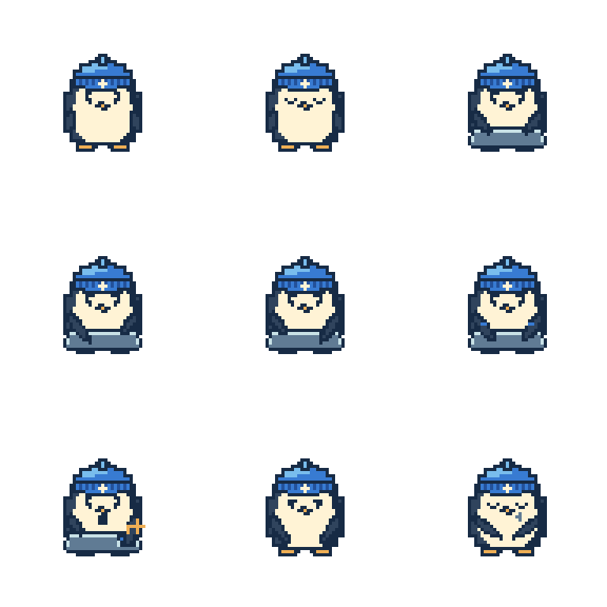
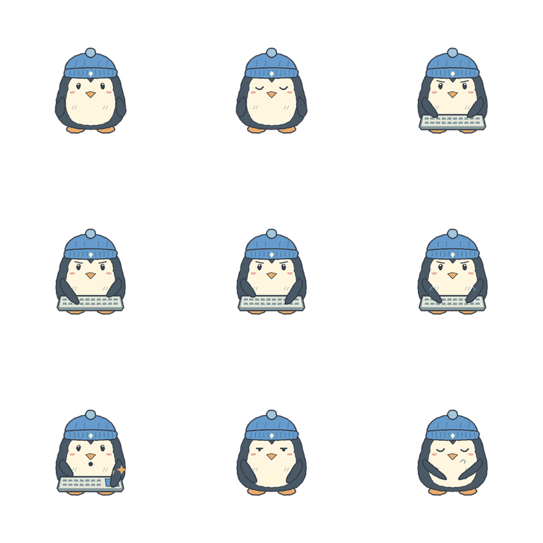
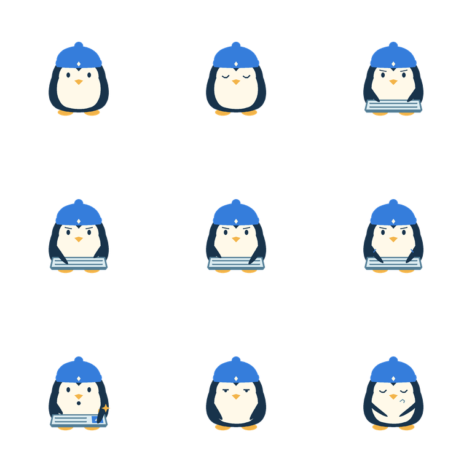
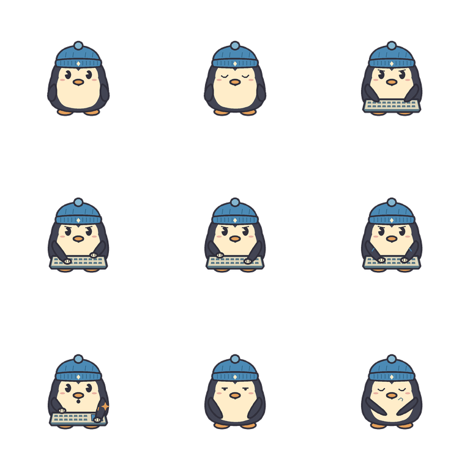
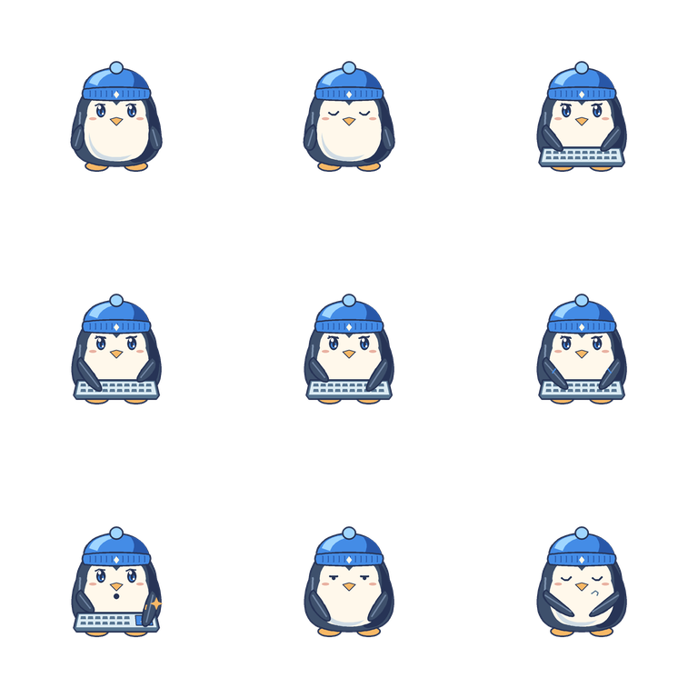
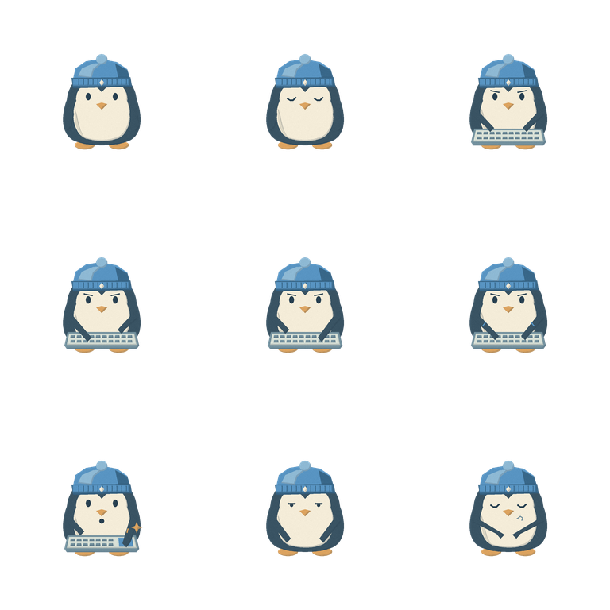

<div align="center">
  
  <h1>Waddly</h1>
</div>

<p align="center">Put your pet on your Mac desktop and let it react to keyboard input.</p>

<p align="center"><a href="README.ja.md">日本語README</a></p>

<p align="center">
  
</p>

## What Waddly does

- Add your own pet images.
- Your pet reacts to keyboard input. Typed text and key codes are not stored.
- While idle, it breathes and blinks, then falls asleep after a while.
- Drag your pet anywhere on the desktop.
- The pet joins every desktop Space. It does not appear above a fullscreen app.
- Right-click the pet and choose “Share Pet” to generate a five-second MP4 (384 × 384) and a 3×3 PNG sprite sheet (nine frames) locally. You can copy the video or the image, and “Post on X” opens the composer with only `#ShareMyWaddly`, so you write the post and attach the file yourself. Waddly has no share save-to-file action.

## Use your own pet

### Prepare a sprite sheet

Choose one of six styles and describe your character in **Create another character**. Pixel Art remains the default; an empty description uses the round blue-beanie penguin shown below. All six examples use the same character and nine poses so you can compare the rendering rather than different subjects. Each preview links to its usable 3×3 PNG; the style links provide the matching prompt block.

| Style and prompt block | Sample 3×3 sheet |
| --- | --- |
| [Pixel Art (default)](prompts/pixel-art-en.md) | [](assets/character-styles/pixel-art.png) |
| [Hand Drawn / Line Art](prompts/hand-drawn-en.md) | [](assets/character-styles/hand-drawn.png) |
| [Iconic / Minimal](prompts/iconic-en.md) | [](assets/character-styles/iconic.png) |
| [Retro Cartoon](prompts/retro-cartoon-en.md) | [](assets/character-styles/retro-cartoon.png) |
| [Anime / Cel Shading](prompts/anime-en.md) | [](assets/character-styles/anime.png) |
| [Paper Cutout](prompts/paper-cutout-en.md) | [](assets/character-styles/paper-cutout.png) |

1. In Setup or Change Character, open **Choose a visual style** in **Create another character**. Compare the two-column gallery and enter your character description. Hover or focus a card for idle/blink, or use **Preview selected style** for a chosen reaction. Reduce Motion keeps samples static. Switching styles or returning to import preserves your description and selection without changing your saved pet.
2. Use **Copy prompt** for any generator, or **Copy the prompt and open ChatGPT** to also open [ChatGPT](https://chatgpt.com/). Paste the prompt there. Waddly does not generate images, call an image model, or send a local reference image automatically.
3. Optionally attach your own reference image manually in the external generator. No attachment is required for a text-only description.
4. Download the transparent PNG and return to Waddly to import it, inspect the nine frames, and use **Adjust frames…** if needed. Continue or Apply saves the result; copying a prompt does not change your saved pet or staged draft.

The [common English prompt](prompts/en.md) and [Japanese prompt](prompts/ja.md) also explain manual composition with any one style block. The complete default pixel-art prompt remains available here:

<details>
<summary>Show the default pixel-art sprite sheet prompt</summary>

```text
Character to draw: A round penguin with a blue beanie, a black back, a white belly, and short orange feet.

Create one 3×3 sprite sheet for Waddly using this character. If I manually attach a reference image, preserve that individual's identity. A reference image is optional.

[Character and held poses]
- Keep the same species, face, body width and height, palette, accessories, facing direction, camera, and scale in all nine cells.
- Keep the head top, body bottom, and horizontal center anchored at the same cell coordinates. Do not resize or shift the character between poses.
- Design for a few held poses at small desktop-pet sizes, not fluid full-body animation. Idle/blink and typing variations need only small changes; drowsy/sleeping keep the same body silhouette. Reserve the larger expression for the Enter reaction, without moving the body anchor.

[Sheet and placement]
- Output one square transparent PNG: a 3×3 grid of nine equally sized square cells, with the canvas side divisible by 3.
- Use genuine alpha transparency: alpha 0 outside the character and props. No simulated checkerboard, colored backdrop, floor, or cast shadow.
- Keep the entire character, accessories, keyboard, and effects within the central 50% of each cell, leaving a 25% safe margin on every side. Nothing may touch a cell boundary or spill into a neighboring cell.
- If a pose does not fit, reduce the gesture or effects, not the character's size. No gutters, divider lines, frames, numbers, captions, logos, or watermarks. No text except an optional Enter-key symbol.

[Nine cells: left to right, then top to bottom]
1. Idle: sitting relaxed.
2. Blink: identical to cell 1 except for closed eyelids.
3. Focused at keyboard: attentive, hands ready.
4. Typing: a small, slow key press.
5. Typing variation: a slightly different hand position from cell 4.
6. Fast typing: a small forward lean and quicker hands, with the body anchor unchanged.
7. Enter-key reaction: an expressive, forceful press on a larger Enter key, returning to the same anchor.
8. Drowsy: heavy eyelids, seated at the idle anchor.
9. Sleeping: eyes closed, resting in the same seated silhouette as cell 8.

[Keyboard and effects]
- Show the keyboard only in cells 3–7. Keep its position, shape, size, perspective, and colors identical wherever it appears; its width is at most 40% of the cell.
- In cell 7 only, emphasize the Enter key within 30% of the cell width. An optional “↵” symbol is allowed, but not the word “Enter”.
- Keep Enter sparkles and at most two short impact strokes next to the body, within the safe area. No effects in neighboring cells.

Output only the sprite sheet image that meets these requirements and the following style guidance.

[Style: Pixel Art]
- Use 16-bit-inspired pixel art, a limited palette, bold pixel outlines, and two or three flat shading tones.
- Keep hard pixel edges without anti-aliasing, blur, gradients, glow, or photorealism. Keep the pixel scale consistent across cells.
```

</details>

You can also create the sprite sheet by hand.

| Reference image | 3×3 sprite sheet |
| --- | --- |
|  |  |

### Image requirements

- Transparent PNG with a square canvas
- Both dimensions divisible by 3
- Maximum file size: 20 MB; maximum side length: 4096 px

An AI-generated sheet can drift slightly in pitch, shifting the character's vertical position between cells even when the prompt asks for a fixed anchor. After importing a 3×3 sheet, **Adjust frames…** opens a crop and alignment editor over the staged draft. It exposes exactly nine fixed cells (2 Idle, 4 Typing, 1 Enter, 2 Sleep); resizing the 1:1 crop only narrows the visible frame, while the Align tool moves the character itself. Pan and zoom the canvas with the trackpad or ⌘+/⌘−/⌘0, and check Before/After with the center crosshair.

Check all nine cells on both light and dark preview backgrounds for baked-in white/checkerboard backgrounds, clipping, neighbor fragments, uneven grid spacing, and changing character size. A valid square PNG is not proof that the poses or transparency are correct. Crop and alignment can recover modest framing drift, but cannot restore missing pixels, remove a baked-in background, or invent a missing pose. Regenerate or repair those defects in an image editor, preserving real transparency and the canonical pose order. Compare idle/blink, the typing group, Enter, and drowsy/sleeping at small display size rather than treating the nine cells as a continuous animation.

Sheets larger than 3072 px on a side are reduced during import, and individual images are capped at 1024 px. The shared character screen accepts a chosen PNG, a window-wide PNG drop, or **Paste from Clipboard** (⌘V). Changes stay a draft until you press Continue or Apply.

Right-click the pet to change its size and behavior, language, visibility, and launch-at-login setting. Disabled commands explain what they need in native menu help, and at least one of Dock or menu bar access must remain on.

When Waddly is the frontmost app, the menu bar also carries the standard menus: **Waddly** (**About Waddly** shows the version and build, plus Hide and Quit), **Edit** (⌘C/⌘V in text fields), and **Window**.

After setup, use **Set Up Input Monitoring…** for permission, status, and recovery guidance, and **Change Character…** to replace or edit images. Initial or unfinished setup opens **Setup Guide…** instead. The Setup Guide and **Change Character…** share one character screen, and a chosen image stays a draft until you press Continue or Apply. A failed save keeps the draft for another try, and closing with a changed draft asks before discarding it. The shared screen says “Currently in use” while it shows the saved pet and “Changes not saved” while a draft would replace it; **Apply** stays unavailable until the draft differs from the saved pet, while the Setup Guide’s **Continue** still advances with an unchanged pet. If macOS requires a restart after you allow Input Monitoring, **Restart Waddly** relaunches the app and returns you to the same setup step.

To create another character after registration, open **Change Character…** from the menu bar or the pet’s right-click menu. **Create another character** stays available with a saved pet or a staged image. Choose a style and description, then copy the current app language's composed prompt. Paste it into your chosen external image generator and import the resulting PNG here. Your current pet and any staged image are unchanged by copying; only Apply saves a replacement. Waddly does not upload images to the generator.

If you have no image yet, **Try the sample pet first** shows the bundled sample immediately; it is stored locally like any pet and you can replace it with **Change image**.

Images are stored on your Mac as individual PNG frames, plus the optional original 3×3 sheet and its crop/alignment metadata when the frame editor was used. Source files are not modified and images are never uploaded. Older prompts may use a different cell order, so use the current prompt.

## Privacy

Keyboard events are used only to control animation. Waddly does not store, log, or transmit typed text or key codes. Images are stored locally on your Mac. Share assets are generated locally when the dialog opens and are not uploaded by Waddly. Copying and posting are user actions. The X logo or text only opens a post composer (carrying `#ShareMyWaddly` and no post text); attach the asset and write your own post.

## Measured memory

The app targets a physical memory footprint below 100 MB in typical use. Importing a very large sheet (for example 3072 × 3072 with nine frames) can exceed that target (a known exception in 1.0). See [CONTRIBUTING.md](CONTRIBUTING.md) for the profiling workflow and the allocator regression suite. The frame editor reuses one Before and one After preview when their image inputs are unchanged, rather than regenerating them for zoom or guide changes. Editor cleanup drops its decoded-sheet and preview references; closing a sheet does not guarantee that process memory immediately returns to its previous level.

## Contributing

See [CONTRIBUTING.md](CONTRIBUTING.md) for development setup and contribution instructions.

### Prompt and sample maintenance

`prompts/en.md` and `prompts/ja.md` own the shared nine-frame contract and localized default character. The twelve flat `prompts/<style-id>-<lang>.md` files contain only compact style guidance. Compose the common `text` block with the description and exactly one style `text` block; the README's complete pixel-art example must equal `SpriteSheetPrompt.load` with its defaults. `AppModelTests` checks that synchronization, and `CharacterStylePromptTests` covers all six styles in both languages and literal description preservation.

Run `python3 Tools/generate_character_samples.py --check` to check the maintained sample assets, plus `mise run test` and `mise run build` on macOS. Keep the same blue-beanie penguin and pose order when refreshing samples. Automated checks do not replace a visual macOS pass for alpha edges, crop bleed, anchor jitter, held-pose readability, and import/preview behavior; perform that pass before shipping updated art.

The sample maintenance tool requires development-only `Pillow==12.1.0`; Waddly itself does not depend on Pillow.

## License

The software is released under the [MIT License](LICENSE), which is also included in the app bundle.
