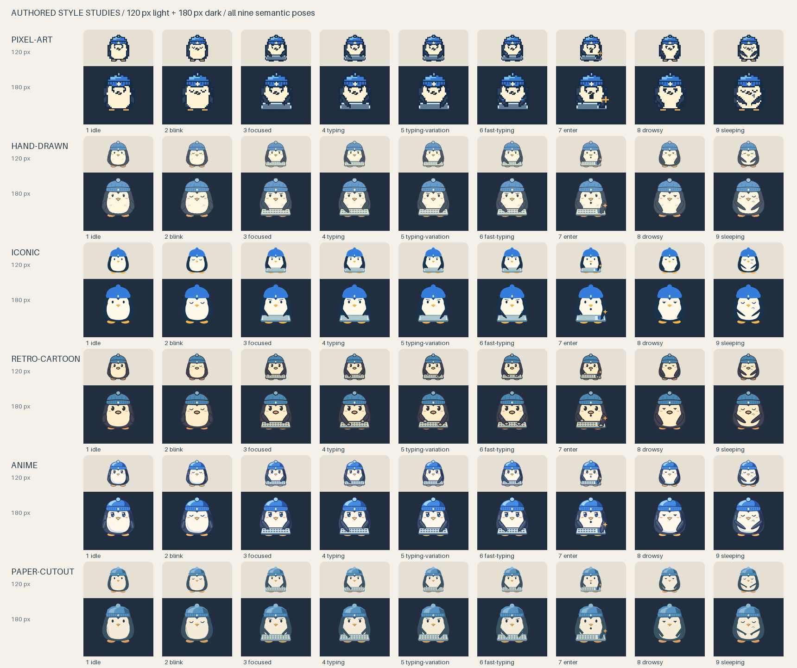

# Authored Character Style Samples / 画風別サンプル

Six functional 3x3 sprite sheets of the same round penguin wearing a blue beanie.
These are **procedurally authored reference artwork**, not outputs from an external
AI image generator, and not evidence that a particular model follows the prompts.
All drawing geometry and rendering treatments live in
[`Tools/generate_character_samples.py`](../../Tools/generate_character_samples.py).
No external artwork, fonts, model calls, or runtime dependencies are used.

同じ青いニット帽の丸いペンギンを、6種類の画風で描いた実用的な3x3シートです。
**スクリプトで描画したオリジナルの参考作例**であり、外部の画像生成AIの出力ではありません。
特定のモデルがプロンプトに従うことを保証する作例ではありません。
描画の形状と画風は上記のスクリプトで管理し、外部素材やアプリ実行時の追加依存は使いません。

## Downloads / ダウンロード

| Style / 画風 | Importable PNG / 読み込み用PNG | Source guidance / 画風プロンプト |
| --- | --- | --- |
| Pixel Art / ピクセルアート | [pixel-art.png](pixel-art.png) | [English](../../prompts/pixel-art-en.md) / [日本語](../../prompts/pixel-art-ja.md) |
| Hand-Drawn / 手描き | [hand-drawn.png](hand-drawn.png) | [English](../../prompts/hand-drawn-en.md) / [日本語](../../prompts/hand-drawn-ja.md) |
| Iconic / ミニマル | [iconic.png](iconic.png) | [English](../../prompts/iconic-en.md) / [日本語](../../prompts/iconic-ja.md) |
| Retro Cartoon / レトロカートゥーン | [retro-cartoon.png](retro-cartoon.png) | [English](../../prompts/retro-cartoon-en.md) / [日本語](../../prompts/retro-cartoon-ja.md) |
| Anime / アニメ | [anime.png](anime.png) | [English](../../prompts/anime-en.md) / [日本語](../../prompts/anime-ja.md) |
| Paper Cutout / 切り絵 | [paper-cutout.png](paper-cutout.png) | [English](../../prompts/paper-cutout-en.md) / [日本語](../../prompts/paper-cutout-ja.md) |



The contact sheet is a review aid, **not an importable sprite sheet**. Each preview
is resized from a whole 256 px cell to 120 or 180 px before its empty margin is
trimmed for layout; the penguin itself is not enlarged to fill the tile. Labels
and backgrounds exist only in this preview, never in the six transparent PNGs.

一覧は確認用であり、読み込み用シートではありません。各セル全体を120pxまたは180pxに
縮小してから、一覧の配置のために透明余白だけを省いています。キャラクター自体の拡大は
していません。背景やラベルは一覧だけにあり、6枚の透過PNGには含まれません。

## Art Contract / 作画仕様

- Each PNG is 768x768 RGBA, with nine exact 256x256 square crops and at least 64 px of genuinely transparent margin on every side of every cell. There are no drawn gutters, floors, or divider lines.
- The frontal camera, body proportions, blue beanie with a diamond stitch, hat anchor, and foot baseline stay fixed. The keyboard appears only in cells 3-7, with the same deck; only cell 7 emphasizes an enlarged Enter key. Wings, motion marks, breath curl, and Enter spark remain inside the safe area.
- Row-major poses are **idle, blink, focused at keyboard, typing, typing variation, fast typing, Enter reaction, drowsy, sleeping**. They are semantic alternatives, not a linear nine-frame animation. Idle/blink differ only around the eyes; typing alternatives move the wings locally; sleeping folds the wings without shifting the entire silhouette.
- Pixel art is drawn on a native 64px grid, enlarged with nearest-neighbor sampling, and uses hard alpha and stepped contours. Hand-drawn uses organic fine outlines and hatch marks. Iconic uses flat, unoutlined geometric masses. Retro cartoon uses heavy ink, pie-cut eyes, a rounded bill, and glove-like typing hands. Anime uses cel-shadow shapes, tapered wings, and layered iris highlights. Paper cutout uses faceted paper pieces, coordinate-locked fiber grain, and internal layered edges, not cast floor shadows.

- 各PNGは768x768のRGBAで、256x256の正方形9セルからなります。各セルの四辺に64px以上の完全な透明余白があり、描かれた溝や床や区切り線はありません。
- 正面のカメラ、体の比率、ひし形の縫い目がある青い帽子、帽子の位置、足元の基準線は固定です。キーボードは3-7コマだけに同じ外形で現れ、7コマ目だけ大きなEnterキーを強調します。羽、動きの線、寝息、Enterのきらめきも安全領域内です。
- 左上から右へ、上から下へ、**待機、まばたき、集中、タイピング、タイピング差分、高速タイピング、Enter反応、うとうと、睡眠**の順です。連続した9コマ動画ではなく、状態ごとのポーズです。まばたきは目の周辺だけ、タイピングは羽だけを小さく変え、睡眠は全体を移動せず羽を折りたたみます。
- ピクセルアートは64pxの描画を最近傍拡大し、中間アルファを使いません。手描きは有機的な細い輪郭とハッチング、ミニマルは輪郭線のない面、レトロは太い線と切り欠いた瞳と丸いくちばしと手袋風の手、アニメはセル影と瞳のハイライト、切り絵は多角形の紙片と固定された紙目と内側の重なりで描き分けています。

## Prompt Provenance / プロンプトとの対応

The shared source contracts are [`prompts/en.md`](../../prompts/en.md) and
[`prompts/ja.md`](../../prompts/ja.md). Combine the shared contract with the
corresponding style guidance linked above and this character description:

> A small round penguin wearing a blue knitted beanie with a tiny cream diamond
> stitch and pompom. Charcoal-blue feathers, a warm white face and belly, short
> wings and orange feet. Frontal seated view; a small blue-grey keyboard.

共通仕様は上記の英語版・日本語版です。共通仕様と各画風の説明を組み合わせ、
キャラクター欄を次のように置き換えると、この作例に対応する生成の出発点になります。

> 小さなクリーム色のひし形の縫い目とポンポンが付いた青いニット帽をかぶる、丸い小さな
> ペンギン。青みのあるチャコール色の羽、温かい白の顔と腹、短い羽とオレンジ色の足。
> 正面向きで座り、小さな青灰色のキーボードを使う。

These descriptions are the intended prompt inputs, **not a claim of an external
generation run**. The reproducible source of these particular PNGs is the Python
script. It interprets the style guidance while sharing geometry, rather than
trying to parse prose prompts as executable instructions. When a prompt's
structural constraints or style changes, review the script, regenerate the
assets, inspect the preview, and run both validation layers below.

この説明は生成に使う想定入力であり、外部AIで実際に生成したという記録ではありません。
この6枚の再現可能なソースはPythonスクリプトです。文章を実行命令として解析するものでは
なく、共通形状を保ちつつ画風の意図を描画で表しています。プロンプトの仕様や画風を
変更したときは、スクリプトを見直し、再生成し、一覧を目視確認して、以下の両方の検証を実行します。

## Reproduction / 再生成

Use Python 3.10+ and **Pillow 12.1.0**, pinned because rasterization and the bundled
preview font are part of the output. Pillow is a development-only dependency;
the app still uses its existing system image APIs. From the repository root:

Python 3.10以上とPillow 12.1.0を使います。描画結果と一覧用の同梱フォントを再現するため
バージョンを固定しています。Pillowは開発時だけの依存で、アプリには追加しません。
リポジトリのルートで実行します。

```sh
python3 -m venv /tmp/waddly-character-samples
/tmp/waddly-character-samples/bin/python -m pip install Pillow==12.1.0
/tmp/waddly-character-samples/bin/python Tools/generate_character_samples.py
/tmp/waddly-character-samples/bin/python Tools/generate_character_samples.py --check
```

Generation writes only the six PNGs, `contact-sheet.png`, and `manifest.json` in
this directory. `--check` never writes: it renders all artwork in memory and
compares **every shipped cell's decoded RGBA pixels** with its authored source.
It checks RGBA mode, dimensions, actual transparent margins, opaque character
pixels, nine distinct poses, exact crop order, identical hat/foot anchor strips,
stable vertical bounds, and binary pixel-art alpha. It also verifies all per-cell
SHA-256 hashes/bounds in the manifest and the full contact sheet. PNG compression
bytes need not be identical; decoded pixels must be. This detects stale images
after source changes, not just plausible PNG headers.

生成コマンドはこのディレクトリの6枚のPNG、一覧、マニフェストだけを書き込みます。
`--check`はファイルを変更せず、メモリ内で再描画した各セルと、実際に配布するPNGの
RGBA全ピクセルを比較します。寸法、透明余白、不透明な本体、9種類のポーズ、切り出し順、
帽子と足元の固定領域、上下端の安定、ピクセルアートの二値アルファを確認します。
セルごとのSHA-256と境界、一覧も検証します。PNGの圧縮バイト列ではなく、デコードした
ピクセルの一致を要求するため、ソース変更後の古い画像も検出できます。

On macOS, also run the normal core tests and build:

macOSでは、実際のインポーターを通すテストと通常のビルドも実行します。

```sh
mise run test
mise run build
```

[`CharacterStyleSampleTests.swift`](../../Tests/WaddlyCoreTests/CharacterStyleSampleTests.swift)
loads the actual repository PNGs via `#filePath`, calls
`PetSpriteSheetImporter.inspect`, and asserts 2 idle / 4 typing / 1 Enter / 2
sleeping frames. It compares every imported frame against its exact source crop,
checks preview availability and the resident memory budget, and verifies clear
margins and fixed hat/foot strips. It needs macOS/AppKit; Linux cannot run it.

このテストは合成画像で代用せず、リポジトリ内の実PNGを読み込み、待機2枚、タイピング4枚、
Enter1枚、睡眠2枚への分類を確認します。すべてのフレームを元画像の切り出しと比較し、
プレビュー、メモリ上限、透明余白、帽子と足元の固定領域も検証します。AppKitが必要なため
Linuxでは実行できません。

## Remaining Visual QA / 残る目視確認

The static light/dark contact sheet has been inspected. Automated geometry and
pixel checks **do not prove animation is jitter-free**. Actual macOS import,
light/dark preview, Frame Editor identity crops, and the running pet lifecycle
still need visual QA: compare idle/blink, the four typing alternatives, Enter
impact, and drowsy/sleeping at 120-180 px without automatic recentering. Check
readability, translucent edge halos, motion comfort, and transitions in both
directions. No macOS animation/no-jitter approval is claimed here.

明暗の静止一覧は確認しましたが、自動の形状・ピクセル検証はアニメーションの揺れがない
ことを証明しません。macOSでの読み込み、明暗プレビュー、フレーム調整画面の初期切り出し、
実際のペットの動作確認は未完了です。120-180pxで位置の自動補正なしに、待機とまばたき、
タイピング4種、Enter、うとうとと睡眠を行き来させ、読みやすさ、半透明縁のにじみ、
動きの快適さを確認してください。macOS上で揺れがないことを確認済みとはしていません。
