# Share flow

The share dialog is the app's only way to hand a pet to another app. It generates both files locally, previews
the exact files it generated, and reports the outcome of each action where the action lives. This page records
what the dialog can actually do, which states it can be in, and what has not been checked by hand yet.

## What the dialog can do

| Asset | Format | Details | Where it goes |
| --- | --- | --- | --- |
| Video | MP4 (H.264) | 384 × 384, 12 fps, 60 frames, 5 s | Clipboard as `public.mpeg-4` |
| Image | PNG | 768 × 768, 3 × 3 cells, nine canonical frames, transparent background | Clipboard as `public.png` |

- Both files are generated on the device with AVFoundation and Core Graphics when the dialog opens. Waddly never
  uploads them.
- There is no save-to-file action. The dialog offers copy and open-composer only, so it does not claim a save path
  it does not have.
- Preview is the exported content: the video card plays the generated MP4 in place (poster frame is the idle
  frame), and the image card shows the generated PNG. Neither preview can be out of date with what is copied.
- The post row opens `https://twitter.com/intent/tweet` with the localized reminder and the `#ShareMyWaddly`
  hashtag. It opens a composer only: Waddly does not attach the files and does not post. If the system cannot open
  the URL, the dialog says so inline instead of looking successful.
- Closing the window cancels generation. The encoder is stopped on the queue that owns it and its partial movie is
  deleted before the temporary files disappear.

## States

| State | What is visible | Available actions |
| --- | --- | --- |
| Working | Spinner and “Preparing share assets…”, cards hidden | Close (cancels generation) |
| Ready | Both cards with real previews and format details, actions enabled | Copy video, Copy image, Post on X, Close |
| Copy succeeded | “Video copied” / “Image copied” next to that card, VoiceOver announcement | Copy again |
| Copy failed | “Couldn’t copy. Try again.” next to that card, VoiceOver announcement | Copy again |
| Composer failed | “Couldn’t open X. Copy the video and attach it yourself.” next to the post button | Post on X again |
| Generation failed | “Could not create the share assets.” with a native “Try Again” button, post disabled | Try Again, Close |
| Closed while working | Nothing: the window is gone and generation stopped | None |

A second generation request while one is running or while assets exist is ignored, so a double trigger cannot
start two exports. Retrying is only possible from the failed state.

## Interaction and accessibility

- Copy buttons and the post button are real `NSButton`s: they take keyboard focus, activate with Space, and show
  the standard focus ring. The post row is a native push button rather than a click gesture on a label.
- Hover changes the button fill to a tinted accent color; press darkens it; disabled controls dim and stop
  responding to hover. Fills use system colors resolved for the current appearance, so light, dark, and increased
  contrast stay legible.
- Feedback is color and text only. No animation is added, so there is nothing to reduce for Reduce Motion; the
  video preview only plays after the user presses play.
- Accessible names describe the operation: “Copy the 5-second video to the clipboard”, “Copy the 3 × 3 sprite
  sheet image to the clipboard”, “Post on X” (with help text that the composer is prefilled and attachments are
  manual), and “Play the exported video” / “Pause the exported video”.
- Status changes are posted as accessibility announcements next to the card they belong to; success is only shown
  after the pasteboard write or the URL open actually succeeded.

## Screenshots

These are rendered from the app's own AppKit views by
[`ShareSnapshotTests`](../Tests/WaddlyAppTests/ShareSnapshotTests.swift), not operating-system screenshots. They
use the repository's example sprite sheet (`assets/examples/nyatinte-bot-3x3.png`) and a throwaway preference
domain; no user images or real preferences are involved, and nothing was tested by hand.

Regenerate the after/state images with:

```sh
WADDLY_CAPTURE_SHARE=1 ./macos/test.sh --filter ShareSnapshotTests
```

The `dialog-before-*` files were rendered from `b0e69e7` (the commit this change starts from) with the same
offscreen rendering approach; `dialog-after-*` and `state-*` were rendered from this change.

| Before, English | Before, Japanese |
| --- | --- |
| 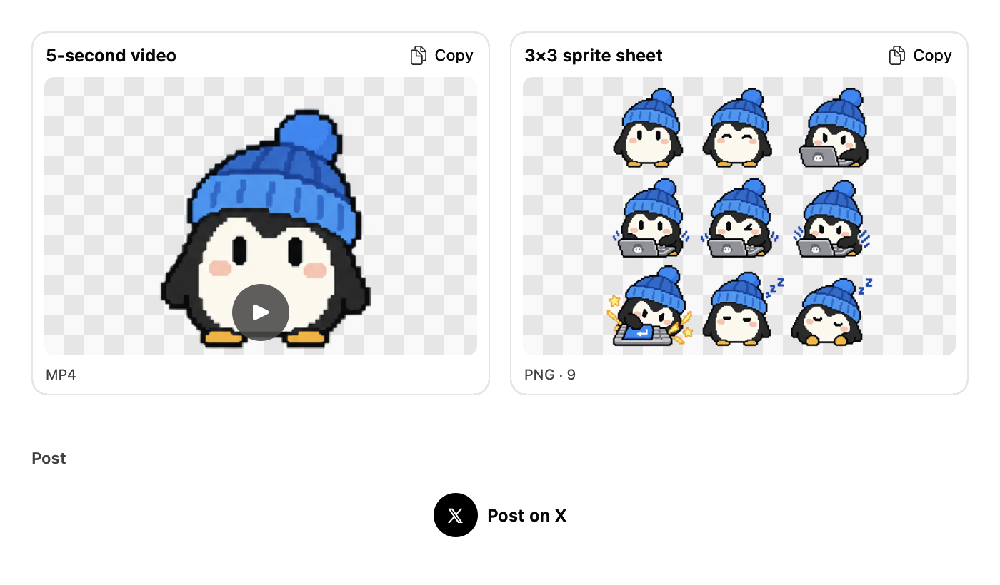 | 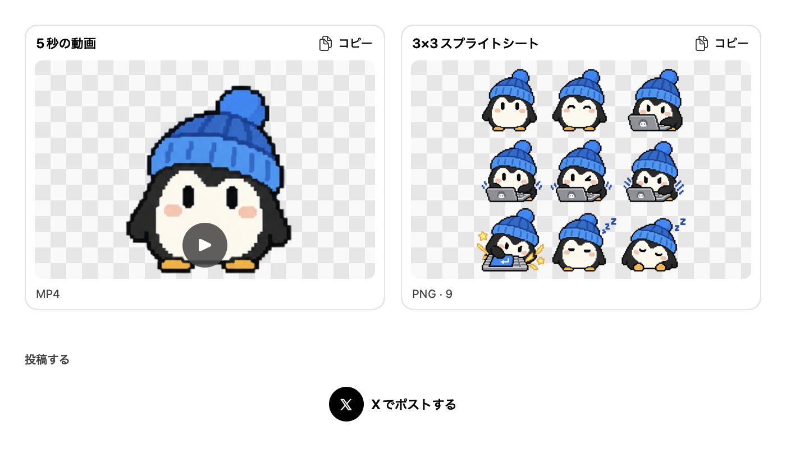 |
| 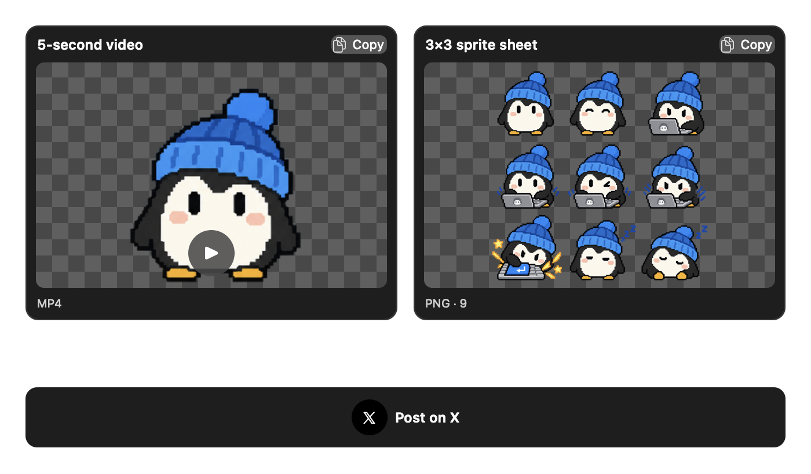 | 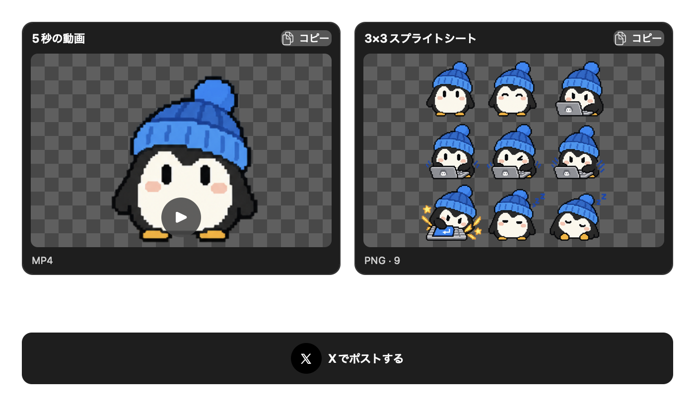 |

| After, English | After, Japanese |
| --- | --- |
| 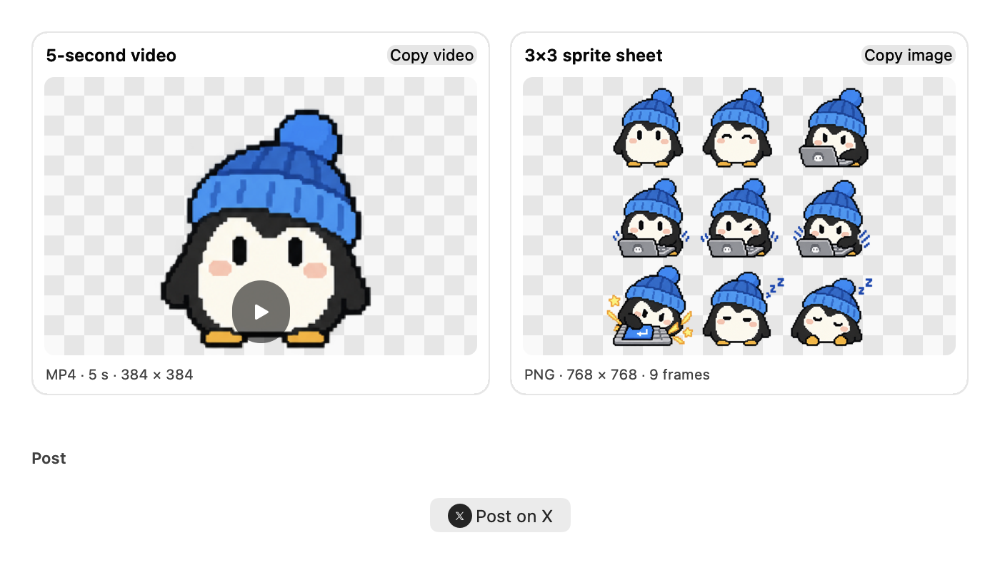 | 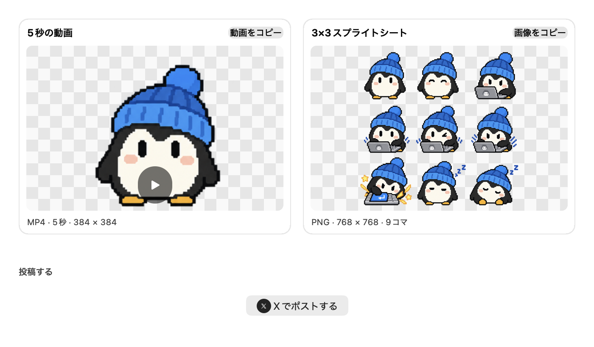 |
| 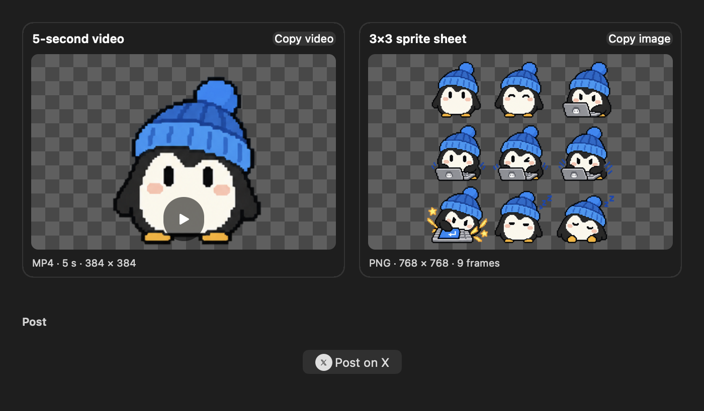 | 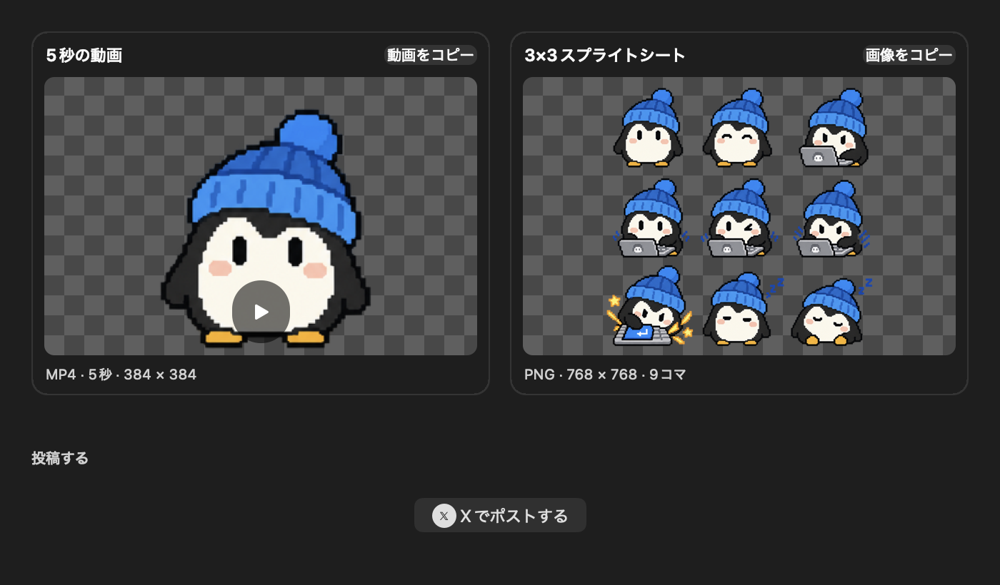 |

| Hover on Copy video | Working |
| --- | --- |
|  | 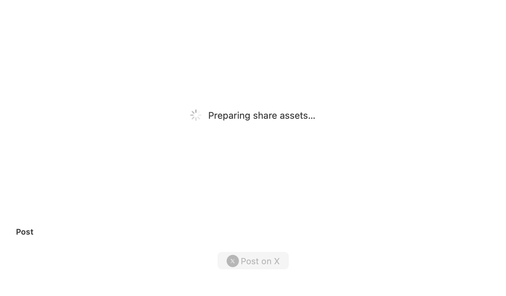 |

| Copied | Copy failed |
| --- | --- |
| 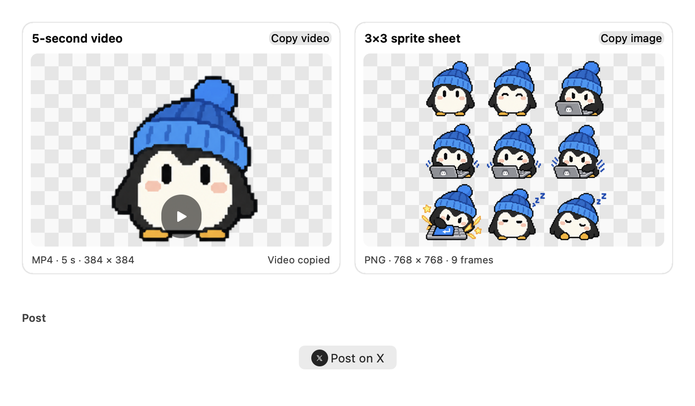 | 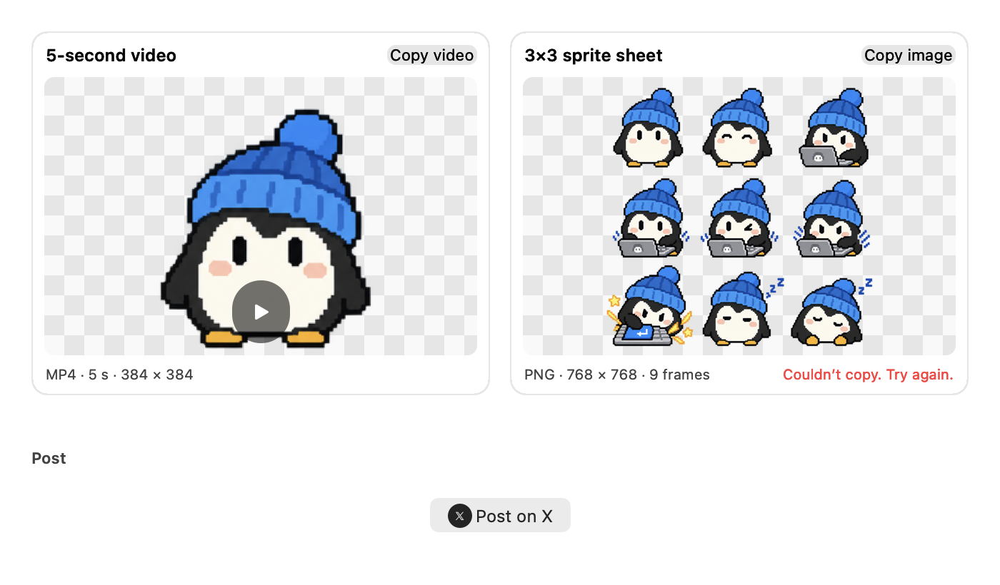 |

| Composer could not open | Generation failed, Japanese dark |
| --- | --- |
|  | 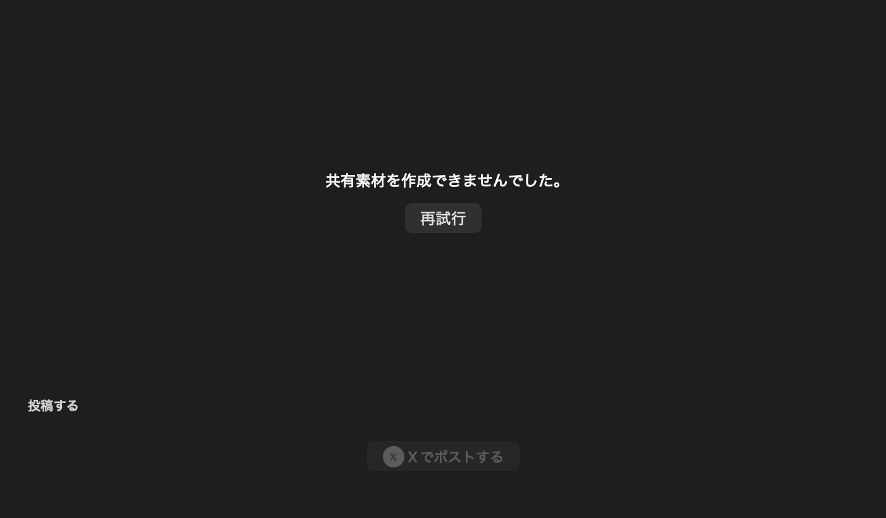 |

## Verification gaps

Automated tests cover the state transitions (working, ready, failed, retry, cancelled), the duplicate guard, copy
success and failure, composer failure, hover state changes, and that a success label does not move the layout.

Not verified by a person in this environment, and still needed before claiming the issue verified:

- VoiceOver: reading order, the copy/post/play names, and the announcements.
- Full Keyboard Access: Tab order, focus-ring visibility, and Space activation.
- Increase Contrast and Reduce Motion with a real system setting.
- Switching light/dark while the window is open.
- Clipboard results pasted into a third-party app, and the X composer opening in a browser with the URL prefilled.
- Display scale and multi-display placement of the dialog.
